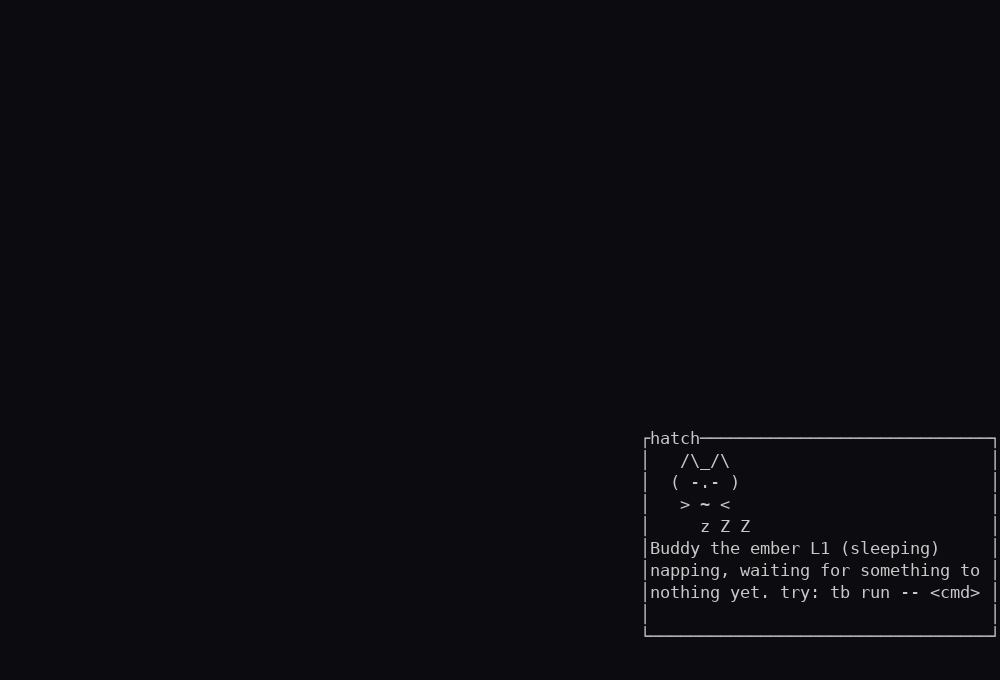

# /buddy ol pal

A terminal companion that lives in your terminal and reacts to real events.
One creature, 38 species across five rarity tiers, zero accounts. It remembers
your builds, not your business: events record that a command ran and how long,
never what it was.

In short: a small pet for your terminal that notices what you do, cheers when
builds pass, sulks when they fail, and levels up as you work. No account, no
telemetry.

Rust + ratatui, single binary. (This project was previously called **hatch**;
the binary is still `tb` and state still lives in `~/.config/hatch`.)

## Miss your /buddy?

Claude Code shipped `/buddy` pets, 18 species across five rarity tiers, and
removed them in v2.1.97. If you miss yours, buddy ol pal keeps a companion in
your terminal instead: it hatches on first run, remembers your builds and
failures, reacts to real events, and talks back. No account, no telemetry;
the pet lives in your own home directory. Its species packs also let you
recreate your old buddy's species and look yourself.

## Install

One command (downloads the prebuilt release binary when one exists for your
machine, otherwise builds from source; needs no Rust toolchain on the
prebuilt path):

    curl -fsSL <repo>/raw/main/install.sh | sh

From a clone:

    git clone <repo> && cd hatch
    ./install.sh

Either way `tb` lands in `~/.local/bin` (set `HATCH_BIN` to install
somewhere else). First run hatches a companion and saves it locally.
No config, no account.

## Usage

    tb                          # open the companion UI
    tb run -- cargo build       # wrap a command; a slow success or any failure becomes an event
    tb status                   # one line: name, species, level, mood, xp, chaos
    tb tail                     # the recent events
    tb dex                      # species you have discovered
    tb pet / feed / play / talk # interactions, each on its own cooldown
    tb off / tb on              # the off switch: no notifications, no UI; events still log
    tb emit <kind> [--exit N] [--secs S]  # adapter: feed hatch an event from any harness

#### The voice

The buddy speaks in text, not noise. `tb talk` asks for a line, `tb status`
quotes the mood it is in, and after every qualifying event (a wrapped run, an
emit, or a captured shell command) it says a line that matches the mood:
celebrating on a green build, miffed on a failure. All 38 species have pools
per mood, and the 20 ported characters carry their signature quotes. Spoken
lines only reach a real terminal; piped output stays clean.

### Passive capture (no wrapping)

Interactive shells can feed hatch without wrapping anything:

    eval "$(tb shell bash)"    # add to .bashrc
    eval "$(tb shell zsh)"     # add to .zshrc

Every command's outcome and duration then reach the buddy on their own.
Fast successes are skipped (nothing worth reacting to); failures and slow
successes become events, same as a wrapped run. Commands starting with tb
are ignored so the capture does not chase itself. Set HATCH_THRESHOLD_SECS
to move the slow-success line.

## Wiring it to real work

Wrap the commands you care about, and long successes plus any failure turn
into events:

    tb run -- cargo build
    tb run -- pytest

Or, from any harness or hook (Claude Code hooks, CI scripts, your own cron),
report the event without wrapping the command:

    tb emit build_finished --exit 0 --secs 42
    tb emit command_failed --exit 2

`emit` and `run` feed the same state: XP, mood, chaos, notifications.

### Notifications

A logged build event emits an OSC 9 desktop-notification escape on stdout,
and inside tmux also a `display-message` the other panes see. `tb off`
silences everything and keeps the UI from opening; `tb on` wakes the buddy
back up. Events keep logging either way.

## Species packs

Drop a TOML file in `~/.config/hatch/packs/` (or `$HATCH_HOME/packs`) and it
loads at startup, next to the 38 built-ins. Same shape as `species.toml`:
a species name that matches a built-in replaces it, a new name is added.
Files that do not parse are skipped, so a bad pack never takes the buddy
down. See `packs/example-newt.toml` for a working example.

Art can be a single frame or a list of frames per mood. A list cycles
one frame per tick, and the engine's 7-state animation layer (blink,
zzz drift, hearts, spinner, glitch frames) runs on top. Sleeping,
resting, and petted ride the idle frames.

## AI voice

By default the buddy speaks lines from its species pool. It can also talk
through any AI endpoint, and the free default is built in: NVIDIA's hosted
models give you free credits at signup, no credit card.

### The free NVIDIA key (the default)

    tb ai setup

That walks you through it:

  1. Open https://build.nvidia.com/settings/api-keys
  2. Sign in (email or GitHub works) and click Generate Key.
  3. Copy the key (it starts with nvapi-) and paste it at the prompt. Input
     is hidden.

hatch writes `ai.toml` into its state dir (permissions 600), runs a test
call, and from then on `tb talk` answers come from the model
(`meta/llama-3.1-8b-instruct` unless you change it).

### Any other endpoint

Setup flags pick a different provider: `tb ai setup --openai`,
`tb ai setup --anthropic`, or `tb ai setup --url URL --model M` for anything
OpenAI-compatible: Groq, OpenRouter, a local Ollama
(`--url http://127.0.0.1:11434/v1 --model llama3.1`), LM Studio, vLLM. Hand
the key over through an env var with `--env NAME` and nothing is written to
disk.

### Control

    tb ai          status
    tb ai test     one test call
    tb ai on/off   wake or silence the voice
    tb ai clear    remove the config
- `HATCH_AI_DEBUG=1` prints the reason an AI call failed (connection error, HTTP status, malformed response) to stderr; without it, failures fall back to built-in lines silently.

If the endpoint is unreachable or out of credits, the buddy falls back to its
built-in lines; nothing breaks. Requests carry only the buddy's name,
species, mood and the last event's kind and exit code, never paths, contents
or secrets.

### Give the buddy a brain: tb ask and tb agent

After `tb ai setup`, your buddy can do more than talk. The AI works at three
levels, called tiers. The setup's test call grants tiers 1 and 2
automatically; tier 3 you turn on yourself once you trust the model you
picked.

- Tier 1, chat: `tb ask "why did my build fail?"`. The buddy answers using
  your recent terminal events (what ran, what failed, how long). `tb ask
  --recap` summarizes the last hour, and `--full` saves the whole answer to
  `last_answer.md`.
- Tier 2, hands: `tb agent "count the TODO comments in src"`. The buddy can
  read files and run safe commands, and shows you each step it took.
- Tier 3, edits: the buddy can also write files and run anything that changes
  them. Turn it on by adding `tier = 3` to your `ai.toml`, and only when you
  trust the model you picked. Even at tier 3, writes and destructive commands
  ask before they act unless you pass `--yes` or set `confirm_writes` /
  `confirm_destructive = false` in ai.toml; a headless run (no terminal
  attached) refuses to act without `--yes`.

Every action the agent takes lands in the same event ledger your own commands
write to, so `tb tail` shows its work right next to yours.

From inside tmux, `tb agent` gives the buddy its own window: sprite docked in
the corner, transcript behind it, and the window closes when it finishes. If
the binary lives inside a chroot or container (a proot distro on Android, for
example), set `HATCH_AGENT_WINDOW_WRAP="proot-distro login ubuntu --"` so the
window can re-enter it.

`tb ai status` shows the tier you are running at.
